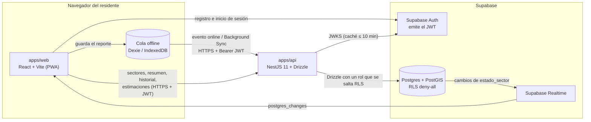
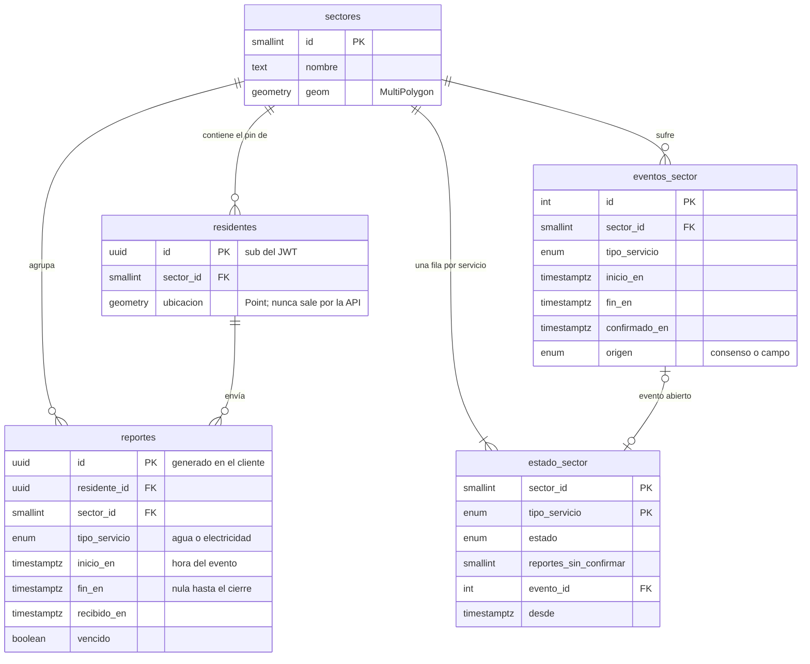
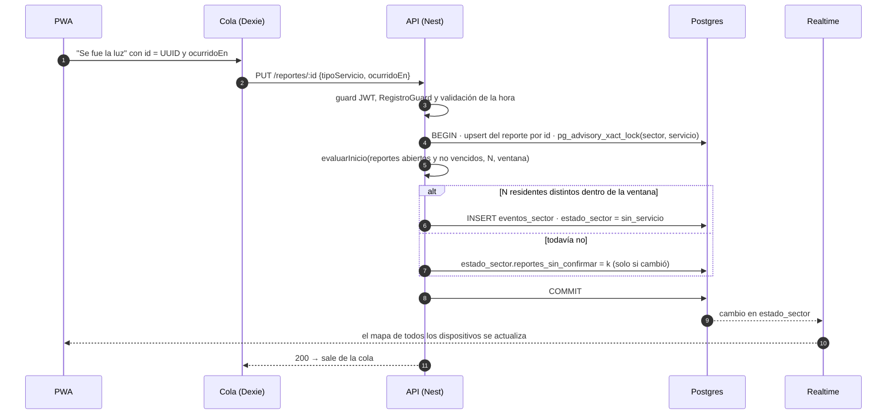

# Arquitectura — BlackoutTracker

> Documentación técnica del backend y de cómo encaja con el frontend (T-060). Describe la API completa del MVP. El detalle de cada regla está en `docs/PLAN.md` y el porqué de cada decisión, en `docs/DECISIONES.md` (se citan como D-0XX).
>
> Al 25-oct-2026, los módulos de abajo están en la pila de PR #31 a #36, que se integra a `staging` en ese orden. La columna *Tarea* de cada tabla indica de dónde sale cada pieza.

## 1. Vista general

La arquitectura tiene tres piezas: la **PWA** (React), una **API REST propia** (NestJS) y **Supabase**, que aporta Postgres + PostGIS, Auth y Realtime. Toda la lógica de negocio vive en la API; el front solo usa Supabase para iniciar sesión y para escuchar los cambios de `estado_sector`.

| Pieza | Qué hace | Qué **no** hace |
|---|---|---|
| PWA (`apps/web`) | Mapa coropleta por sector, formularios de inicio y restablecimiento, cola offline, panel de estimación | No lee ni escribe reportes en Supabase directamente; no ve coordenadas ajenas |
| API (`apps/api`) | Valida el pin, guarda los reportes, decide el consenso, calcula la mediana, escribe `estado_sector` | No emite tokens (solo verifica los de Supabase) ni abre WebSockets |
| Supabase | Postgres + PostGIS, Auth (JWT con claves asimétricas) y Realtime sobre `estado_sector` | No contiene lógica de negocio (sin funciones, triggers ni `pg_cron`) |

## 2. Módulos de la API

Cada carpeta de `apps/api/src/` es un módulo de Nest con una responsabilidad. La lógica de dominio que exige cobertura vive en archivos `*.puro.ts`, que no importan Nest ni Drizzle: reciben datos (y el reloj) y devuelven datos. Los servicios solo leen, serializan y escriben.

| Módulo | Responsabilidad | Rutas (`/api/...`) | Tarea |
|---|---|---|---|
| `config` | Valida el `.env` al arrancar; si algo falta o no sirve, la API no levanta | — | T-003 |
| `db` | Drizzle con postgres-js, esquema, tipo `MultiPolygon`, migrador propio (D-020), siembra de sectores e importación del dataset de campo (`db:seed:campo`, D-025) | — | T-005, T-010, T-012, T-044 |
| `auth` | Guard global: verifica el JWT de Supabase con `jose` contra el JWKS (solo ES256/RS256, emisor y audiencia); `@Public()` y `@ResidenteActual()` | — | T-013 |
| `comun` | Filtro de errores que agrega `codigo`, `ErrorNegocio`, reloj inyectable y límites de throttle y de body | — | T-003, T-031, T-051 |
| `salud` | Estado de la API y ping a la base (sirve de keep-alive) | `GET /salud` | T-003, T-005 |
| `sectores` | Polígonos de los sectores como GeoJSON, con `Cache-Control` | `GET /sectores` | T-014 |
| `residentes` | Registro en dos pasos (D-014): valida el pin con `ST_Covers` (D-002) y crea el perfil; `RegistroGuard` (403 `REGISTRO_INCOMPLETO`) | `POST /registro/validar-pin`, `POST /residentes/me`, `GET /residentes/me` | T-015 |
| `reportes` | Inicio y cierre idempotentes, validación de la hora (`tiempo.puro.ts`), vencimiento (`vencimiento.puro.ts`) | `PUT /reportes/:id`, `PATCH /reportes/:id/cierre`, `GET /reportes/mios` | T-020..T-023, T-040, T-050 |
| `consenso` | `evaluarInicio` y `evaluarRestablecimiento` (puros), `ConsensoService` (lock, evento y `estado_sector`) y `ConsensoCron` | — | T-030..T-033, T-050 |
| `historial` | Eventos cerrados de un sector, paginados por cursor (`cursor.puro.ts`) | `GET /sectores/:id/historial` | T-034 |
| `estimacion` | `mediana`, `cuartiles` y `resumir` (puros) y la consulta con `percentile_cont` | `GET /estimaciones` | T-041, T-042 |
| `resumen` | Panel de un sector (VIS-04): por servicio, estado, estimación con su n y los últimos 5 eventos | `GET /sectores/:id/resumen` | T-043 |

`packages/shared` es la frontera entre la API y la PWA: enums (`TipoServicio`, `EstadoServicio`, `OrigenEvento`), interfaces de los DTO, `CodigoError` con su estado HTTP, los valores por defecto (N, n_min, ventanas) y `accionDeRespuesta`, la tabla del contrato de la cola offline (§6). No tiene dependencias de runtime: los DTO con `class-validator` viven en la API y implementan esas interfaces.

El contrato completo de cada ruta está en `docs/openapi.json` (exportado con `pnpm docs:openapi`) y, con la API corriendo, en `/api/docs`.

## 3. Modelo de datos

Una **única tabla de reportes** para agua y luz, diferenciados por `tipo_servicio`. Todas las horas son `timestamptz` en UTC y las geometrías usan SRID 4326. El detalle de columnas, checks e índices está en `docs/PLAN.md` §4.

- **`reportes`** es la entrada: lo que dice cada residente. El check `fin_en >= inicio_en` impide duraciones negativas (REP-07) y un índice único parcial impide dos reportes abiertos del mismo servicio por residente (REP-05); agua y luz sí conviven (REP-06).
- **`eventos_sector`** es el corte confirmado por consenso (o importado de la campaña de campo, `origen = 'campo'`). Un índice único parcial garantiza a lo sumo un evento abierto por sector y servicio (CON-03).
- **`estado_sector`** es la salida que ve el mapa: una fila por sector y servicio, sin ningún dato personal. Es la única tabla publicada en Realtime y la única legible con la clave anónima.
- El estado de sincronización (`pendiente | enviado | error`) es del modelo del cliente (D-011); el servidor guarda `recibido_en` para auditar los envíos diferidos.

## 4. Flujo de un reporte

### 4.1 Inicio: de un reporte al cambio de estado

1. El cliente genera el **id del reporte** (UUID) y guarda la **hora del evento** (`ocurridoEn`), no la del envío (OFF-03).
2. La API valida la hora (`tiempo.puro.ts`, D-013): no más de 2 min en el futuro ni más de 7 días en el pasado; si no, 422 `HORA_INVALIDA`. Nunca la corrige en silencio.
3. El sector del reporte es el del residente, fijado al registrarse; el cliente no lo elige.
4. En la **misma transacción** que el reporte, `ConsensoService` toma un *advisory lock* por (sector, servicio) para serializar los reportes simultáneos (D-010) y llama a la función pura.
5. **`evaluarInicio`** ordena los reportes abiertos por hora y recorre una ventana deslizante del ancho del servicio (30 min la luz, 180 min el agua; D-004). Hay consenso si en alguna ventana hay **N residentes distintos**: el mismo residente cuenta una sola vez (CON-04), los sectores nunca se suman (CON-05) y los reportes fuera de la ventana no cuentan (CON-07). La hora de inicio del evento es la **mediana** de las horas de esos N reportes (D-007), así un reloj manipulado no la mueve.
6. `estado_sector` solo se escribe si algo cambió, para no disparar Realtime en vano. Con N − 1 reportes el estado no cambia, pero `reportes_sin_confirmar` permite mostrar "sin confirmar" (CON-01); con N + 1 no hay eventos duplicados (CON-03), porque el consenso se recalcula desde el estado y no suma deltas.

### 4.2 Cierre y restablecimiento

`PATCH /reportes/:id/cierre` con `{ocurridoEn}` cierra el reporte del residente y calcula su duración. Un cierre sin inicio se bloquea con 404 (D-003): para la cola offline ese 404 es reintentable, porque el inicio puede venir en camino.

**`evaluarRestablecimiento`** cierra el evento del sector (CON-06) cuando hay N residentes distintos que reportaron el regreso dentro de una misma ventana, **o** cuando ya no queda ningún reporte abierto en el sector y servicio (todos los que reportaron dijeron que volvió). La hora de fin es la mediana de esos cierres. Al cerrarse, el evento pasa a ser un **ciclo completo** y entra en la estimación.

### 4.3 El tiempo también cambia el estado

Algunas transiciones no las provoca un reporte nuevo, sino el reloj:

- **Ventanas que vencen** (CON-07): un reporte "sin confirmar" deja de contar cuando su ventana pasa.
- **Reportes vencidos** (T-050, D-015): un reporte abierto hace más de `REPORTE_VENCE_HORAS` (48 h) se marca `vencido`. Deja de contar para el consenso y libera la restricción de REP-05, así un olvido no bloquea al residente para siempre. Si un evento abierto se queda sin reportes vivos, se cierra: con la mediana de los cierres si alguien avisó del regreso, o como **`incompleto`** (sin `fin_en`) si nadie lo hizo (D-024). Un ciclo incompleto no entra en la mediana ni aparece en el historial ni en el resumen, y el corte siguiente abre su propio evento.

`ConsensoCron` (`@nestjs/schedule`) hace ese barrido cada minuto. Como Render gratis se duerme, el cron es *best effort*: las lecturas (`/resumen`) también recalculan el par si su estado puede estar viejo (`refrescarSiViejo`).

## 5. Estimación estadística

La duración típica de un corte de un sector *s* y un servicio *v* es la mediana de los ciclos completos:

T̂(s,v) = mediana{ fin_i − inicio_i : i ∈ C(s,v) }

- *C(s,v)* son los **eventos de sector cerrados** (por consenso o del dataset de campo), no los reportes individuales (D-008): un corte reportado por seis vecinos es un solo ciclo. Los ciclos abiertos no entran.
- Se usa la **mediana** porque es robusta: un corte atípico de 30 h no mueve la estimación (EST-03). Con una cantidad par de datos se promedian los dos centrales (EST-02).
- Con menos de **n_min = 5** ciclos, la respuesta es `suficiente: false` y solo el n: el front muestra "datos insuficientes" (EST-04). La cifra **siempre va con su n** ("aprox. 4 h, según 12 cortes").
- Agua y luz nunca se mezclan (EST-05). No hay caché: la mediana se recalcula en cada consulta y cambia en cuanto se cierra un ciclo (EST-06).
- La consulta usa `percentile_cont(ARRAY[0.25, 0.5, 0.75])` con el helper `sql` de Drizzle; un test verifica que la mediana del SQL y la de `estadistica.puro.ts` coinciden sobre el mismo dataset. Los cuartiles dan el rango intercuartílico opcional; no se usan intervalos que supongan normalidad.

Es una **estimación estadística** (un estimador de tendencia central), no un modelo entrenado. Su error estándar es ≈ 1,2533·σ/√n: con 6 ciclos es orientativa, con 25 fiable y con 100 estable.

## 6. Modo sin conexión (contrato con la cola)

El front guarda cada reporte en **IndexedDB** (Dexie), nunca en memoria, y lo envía con el evento `online` (y Background Sync donde exista), en **orden cronológico** (OFF-04). La API lo hace seguro de reintentar:

- **Idempotencia** (OFF-05): el id del reporte lo genera el cliente y es la clave primaria. Repetir el mismo `PUT` o el mismo cierre devuelve 200 con lo que ya existe; el mismo id con otro contenido es 409 `REPORTE_CONFLICTO`. Un corte de la red a mitad del envío nunca duplica el reporte.
- **Hora del evento** (OFF-03): se guarda `ocurridoEn` tal como llega, dentro de los límites de D-013.

Qué hace la cola con cada respuesta (`accionDeRespuesta` en `@blackout/shared`, T-040):

| Respuesta | Acción del cliente |
|---|---|
| 2xx | Éxito: sale de la cola |
| Sin respuesta (red caída o corte a mitad del envío), 5xx o 429 | Reintenta con backoff |
| 404 en un cierre (el inicio todavía no llega) | Reintenta |
| 400, 409, 422 y el resto de 4xx | Error permanente: sale de la cola marcado `error` y se avisa al usuario |
| 401 | Refresca la sesión y reintenta |

Todo error lleva un campo `codigo` (`CodigoError`), para que el front muestre el mensaje en español sin depender del texto del servidor.

## 7. Privacidad (NF-06)

Nadie puede ver las coordenadas de otro residente; solo datos agregados por sector. Lo garantizan tres barreras independientes:

1. **La API nunca devuelve coordenadas.** La ubicación del residente solo se usa dentro de la base para calcular su sector. Ningún DTO tiene campos de ubicación, y un e2e (T-016) recorre todas las rutas publicadas en Swagger, con éxito y con error, y falla si una respuesta trae claves como `ubicacion`, `lat` o `lng`, o las coordenadas sembradas; también falla si aparece una ruta nueva sin caso.
2. **RLS deny-all en Supabase** (T-011). Las cinco tablas tienen RLS activado y `REVOKE ALL` para `anon` y `authenticated`; la única excepción es `SELECT` sobre `estado_sector`, lo que el front lee por Realtime. Nest se conecta con un rol que se salta RLS, así que la regla protege la Data API de Supabase, no a la API propia.
3. **El mapa es una coropleta**: colorea el polígono de cada sector según su estado. Un mapa de puntos expondría dónde viven los que reportan.

## 8. Seguridad

- **Autenticación:** Supabase Auth emite el JWT; la API solo lo verifica (guard global con `jose`, JWKS con caché de 10 min, solo algoritmos asimétricos, emisor y audiencia; D-021). El `sub` del token es el id del residente. Las rutas públicas (`/salud`, `/sectores`, `validar-pin`) se marcan con `@Public()`.
- **Entrada:** `ValidationPipe` global con `whitelist` y `forbidNonWhitelisted`; cuerpo JSON limitado (413 al pasarse) y JSON mal formado como 400.
- **Abuso:** throttle general por IP y límites propios en las rutas sensibles (registro, escritura de reportes); `TRUST_PROXY` hace que, detrás de Render, el límite vea la IP real.
- **Cabeceras y CORS:** Helmet, y CORS solo para los orígenes de `CORS_ORIGINS`, con los métodos y cabeceras que usa la API y sin cookies.
- **Sin administrador** (NF-07): no existe ningún rol con más permisos que un residente; el consenso reemplaza al moderador.
- **Limitación conocida:** no hay protección contra cuentas falsas (Sybil); está fuera del alcance del MVP.

## 9. Lectura desde la Teoría General de Sistemas

| Concepto de la TGS | Dónde está en el sistema |
|---|---|
| **Entrada** | Los reportes de los residentes: `PUT /reportes/:id` (inicio) y `PATCH /reportes/:id/cierre` (restablecimiento), módulo `reportes` |
| **Proceso: validación** | Punto en polígono del registro (`residentes`, `ST_Covers`) y validación de la hora (`tiempo.puro.ts`) |
| **Proceso: regulación** | El consenso (`consenso.puro.ts`, `ConsensoService`): N residentes distintos dentro de una ventana |
| **Proceso: estadística** | La mediana de los ciclos cerrados (`estadistica.puro.ts`, `estimacion`) |
| **Salida** | `estado_sector` publicado por Realtime (el mapa), `/sectores/:id/resumen`, `/historial` y `/estimaciones` |
| **Retroalimentación** | Cada evento que se cierra entra en el universo de la mediana y la estimación mejora (EST-06); el n que se muestra hace visible cuánto se sabe |
| **Homeostasis / autorregulación** | Sin administrador, el estado de un sector solo cambia cuando la comunidad coincide; un reporte aislado o malintencionado no lo altera, y el tiempo (ventanas y vencimiento) devuelve el sistema al equilibrio |
| **Isomorfismo** | Agua y luz comparten la misma tabla, los mismos algoritmos y el mismo flujo entrada → proceso → salida; solo cambia el parámetro de la ventana |
| **Entorno** | Las empresas prestadoras (fuera del sistema: no hay integración), la red móvil intermitente (de ahí el modo sin conexión) y la plataforma gratuita (Supabase y Render, que se pausan o se duermen) |
| **Frontera** | La API: todo lo que entra se valida en ella y todo lo que sale es agregado por sector |

## 10. Despliegue

| Componente | Dónde | Notas |
|---|---|---|
| Web | Vercel, Netlify o Cloudflare Pages (gratis) | Lo despliega Freddy |
| API | Render (plan gratis) o el Coolify de Botinfy | `deploy-api.yml` dispara el *deploy hook* tras un CI verde; se duerme sin tráfico (arranque en frío de 30–60 s), por eso `keepalive.yml` hace ping a `/api/salud` |
| Base | Supabase: un proyecto de piloto y uno de staging | El plan gratis **se pausa tras ~7 días sin actividad**: despausarlo antes de las pruebas de campo y de la defensa |

Las migraciones se aplican con el migrador propio (`pnpm db:migrate`, D-020) y los sectores con `pnpm db:seed`. En Supabase, PostGIS vive en el esquema `extensions`; la conexión fija `search_path=public,extensions` para que el mismo SQL corra en local y en la nube.
